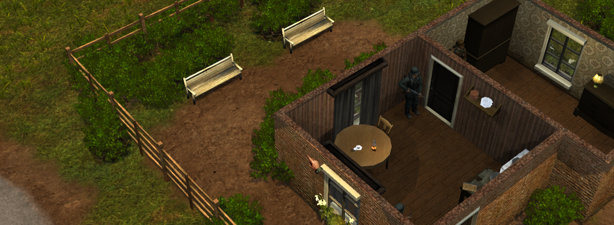
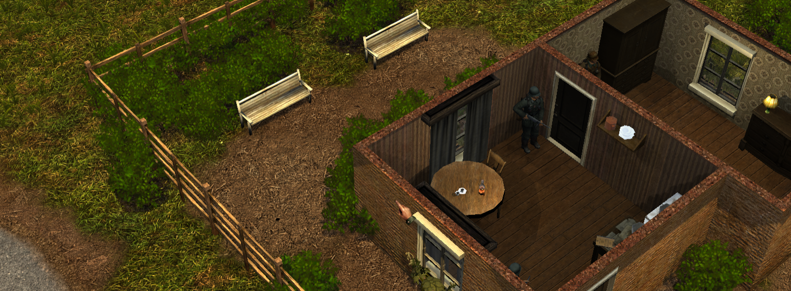

# Silent Storm Remaster

[Русский](README.md) · English

A modern engine for **Silent Storm 1.2**, based on [Silent Storm Reconstruction](https://github.com/met-nikita/Silent-Storm-Reconstruction) and [Nival's original source code](https://github.com/nival/Silent-Storm).

## How to play on desktop

1. [Download the launcher](https://github.com/mrartanis/silent-storm-remaster/actions/workflows/launcher-release.yml?query=is%3Asuccess). Open the latest successful build and choose the Windows x64, Linux x64, or macOS ARM64 archive under **Artifacts**.
2. Extract the full archive and open `SilentStormLauncher.exe` on Windows, `SilentStormLauncher` on Linux, or `SilentStormLauncher.app` on macOS.
3. Select the folder of your Steam or GOG copy of Silent Storm 1.2. In the launcher, select **Download** next to Engine, then **Play**. [Full installation guide](docs/launcher.en.md)

## Features

- A 64-bit engine for Windows, Linux, macOS, and Android that reads the original game data.
- Widescreen support, scalable UI, vector fonts, and a modern renderer.
- HD textures on desktop and touch controls on Android.
- A [desktop launcher](docs/launcher.en.md) for installing and updating the engine and HD pack.
- Two-player tactical matches with an option to [play against an LLM agent](docs/agent-play.en.md).
- Native playback of the original audio and cutscenes, plus a new implementation of facial animation.

| Original textures | HD textures |
| :---: | :---: |
|  |  |

## Releases

- [Latest engine release](https://github.com/mrartanis/silent-storm-remaster/releases/latest) · Windows x64, Linux x64, macOS ARM64, Android ARM64.
- [All releases](https://github.com/mrartanis/silent-storm-remaster/releases) · The HD pack and desktop launcher are released separately.

## Documentation

[Desktop installation and HD textures](docs/install.en.md) · [Android](docs/android.en.md) · [Multiplayer](docs/multiplayer.en.md) · [Build from source](docs/build.en.md) · [Publish releases](docs/releasing.en.md) · [License](LICENSE.md)
