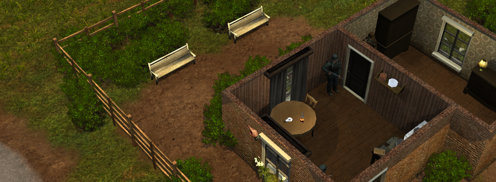
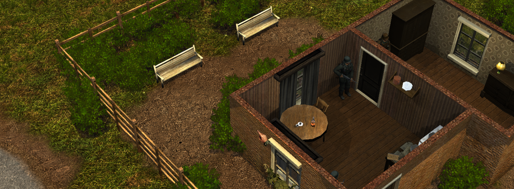

# Silent Storm Remaster

Русский · [English](README.en.md)

Современный движок для **Silent Storm 1.2** на основе [Silent Storm Reconstruction](https://github.com/met-nikita/Silent-Storm-Reconstruction) и [исходников Nival](https://github.com/nival/Silent-Storm).

## Запуск и установка

1. Понадобится купленная **Silent Storm Gold Edition** в Steam или GOG и данные основной игры версии **1.2**.
2. Скачайте лаунчер для своей системы, распакуйте архив и запустите приложение. [Windows x64](https://github.com/mrartanis/silent-storm-remaster/releases/latest/download/silent-storm-launcher-windows-x64.zip) · [Linux x64](https://github.com/mrartanis/silent-storm-remaster/releases/latest/download/silent-storm-launcher-linux-x64.tar.gz) · [macOS ARM64](https://github.com/mrartanis/silent-storm-remaster/releases/latest/download/silent-storm-launcher-macos-arm64.zip)
3. Укажите папку основной Silent Storm или нажмите **Импорт из GOG…** и выберите полный офлайн-установщик `setup_….exe`, оставив все его `.bin` рядом. Распаковщик уже входит в лаунчер — устанавливать его отдельно не нужно.
4. Скачайте движок и, если хотите, HD-пак прямо в лаунчере. Он сам установит всё необходимое.
5. Нажмите **Играть**. Вы великолепны.

## Возможности

- 64-битный движок для Windows, Linux, macOS и Android с поддержкой оригинальных игровых данных.
- Широкоформатный режим, масштабируемый интерфейс, векторные шрифты и обновлённый рендерер.
- HD-текстуры для настольных версий и сенсорное управление на Android.
- [Настольный лаунчер](docs/launcher.md) для установки и обновления движка и HD-пака, с импортом игровых данных из офлайн-установщика GOG.
- Тактические матчи для двух игроков, в том числе [против LLM-агента](docs/agent-play.md).
- Нативное воспроизведение оригинальных звуков и роликов, собственная реализация лицевой анимации.
- Сравнение оружия в инвентаре с активным оружием персонажа; на Android подробности открываются удержанием пальца.
- Настраиваемое ускорение чужих ходов ×2, ×3 или ×4 в одиночной пошаговой игре. По умолчанию ускорение выключено.
- Справка по текущим клавишам управления и заменитель цифрового блока (numpad) на Mac.

Новые удобства основаны на идеях [Gunnarguy из проекта Silent-Storm-Mac](https://github.com/Gunnarguy/Silent-Storm-Mac) и адаптированы для нашего движка. Они настраиваются в **Настройки → Игра → Удобства**; подробности — в [инструкции](docs/install.md).

| Оригинальные текстуры | HD-текстуры |
| :---: | :---: |
|  |  |

## Релизы

- [Последний релиз движка](https://github.com/mrartanis/silent-storm-remaster/releases/latest) · Windows x64, Linux x64, macOS ARM64, Android ARM64.
- [Все релизы](https://github.com/mrartanis/silent-storm-remaster/releases) · Лаунчер входит в релизы движка, HD-пак выходит отдельно.

## Документация

[Установка на компьютере и HD-пак](docs/install.md) · [Android](docs/android.md) · [Сетевая игра](docs/multiplayer.md) · [Сборка](docs/build.md) · [Публикация релизов](docs/releasing.md) · [Лицензия](LICENSE.md)
